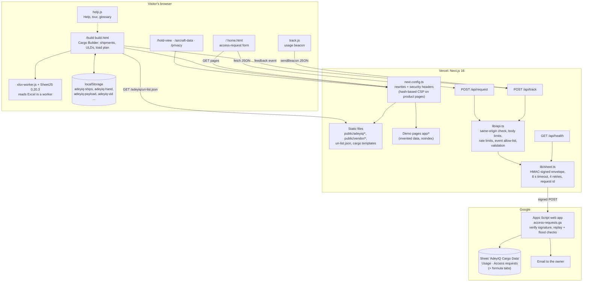

# AdeyIQ system and API map

Checked on 24 November 2026 against `main` at `c8a23ff` (live at https://adeyiq.vercel.app).

## Summary

- **No database, no ORM, no migrations, no user accounts.** There is nothing to create, read, update or delete on a
  server. Data lives in two places only:
  1. **The owner's Google Sheet** "AdeyIQ Cargo Data", written by a Google Apps Script web app
     (`scripts/access-requests.gs`) that accepts only signed, append-only writes from the website.
  2. **The visitor's own browser** (`localStorage`): shipments, hand changes, payload figures. Cargo never leaves the
     device.
- **Three API routes** (Next.js 16 App Router): `GET /api/health`, `POST /api/track`, `POST /api/request`.
  Everything else is static: 5 product pages, 9 demo pages, and data files.
- **Verification:** `scripts/verify-endpoints.mjs` checks every endpoint with a valid request and with invalid ones.
  Results on 24 Nov 2026: **49/49** pass on a local server with a stand-in sheet, **42/42** with no sheet configured,
  **29/29** read-only checks on the live site. No endpoint answers 500.
- **No sample CRUD endpoints were added** (see "Why there are no sample endpoints").

## 1. Architecture and data flow



## 2. Data models

### Server side (written to the Google Sheet; append only)

| Model | Where it is defined | Fields and types | Validation | Relationships |
|---|---|---|---|---|
| **UsageEvent** | `lib/api.ts` `handleTrack`; sent by `public/adeyiq/track.js` | `event` string (allow-list of 14), `page` ≤80, `visitor` ≤20, `session` ≤20, `aircraft` ≤40, `detail` ≤300, `w` number → `device` (phone/tablet/desktop), `ref` ≤200, + `country` ≤4, `region` ≤60, `city` ≤80 from Vercel headers | Same origin; bots dropped (204); 60/min/IP; body ≤4 KB; JSON object; `event` in `EVENTS` | `visitor` groups events of one browser (random id; `owner-…` for the owner); `session` groups one visit. No foreign keys. |
| **Feedback** | builder ★ Rate dialog → `/api/track` | A UsageEvent with `event: "feedback"` and `detail: "q1=..|q2=..|q3=..|q4=..|q5=..|role=..|c=.."` | as UsageEvent; comment ≤150 chars, `|` and line breaks removed | same as UsageEvent |
| **AccessRequest** | `lib/api.ts` `handleRequest`; form in `home.html` | `name` ≤200 (required), `email` ≤200 (required, `x@y.zz`), `company` ≤200, `phone` ≤60, `modules` string[] ≤5 × ≤60, `message` ≤2000, `page` = city, country | Same origin; 5/hour/IP; body ≤8 KB; JSON object; honeypot `website` (answers ok, saves nothing) | none |
| **SignedEnvelope** | `lib/sheet.ts` `signEnvelope` ↔ `access-requests.gs` `verify_` | `v: 1`, `ts` ms, `nonce` 16–64 chars, `payload` JSON string ≤10,000, `sig` = base64 HMAC-SHA256(key, `ts.nonce.payload`); payload carries `type` (`usage`/`request`) and `rid` (request id shared by retries) | Key ≥32 chars or every write refused; ±5 min clock; nonce used once (10 min); ≤120 writes/min; a repeated `rid` is answered ok without writing again | wraps one UsageEvent or AccessRequest |
| **Sheet row: Usage** | `access-requests.gs` | Time, Event, Page, Visitor, Session, Country, Region, City, Aircraft, Detail, Device, Came from | formula-like text stored as plain text | read by the Clean usage, Traffic summary and Feedback tabs (formulas) |
| **Sheet row: Access requests** | `access-requests.gs` | Time, Name, Email, Company, Phone, Modules, Message, Location, Status (`New`) | as above; email to owner ≤50/day | none |

### Browser side (never sent to a server)

| Model | Storage key | Fields and types | Validation | Relationships |
|---|---|---|---|---|
| **Shipment** | `adeyiq-ships` (array) | `id`, `awb` ≤40, `pcs` int ≥1, `rate` per chargeable kg 0–100,000 (Module 2), `prio` ''/contract/mail/standby (Module 2), `l` `w` `h` cm, `wt` kg (total), `nat` ≤200, `shc` string[] ≤12 × ≤8, `dg` class from the DG list, `sub` string[] ≤4, `un` `UN####`, `excl` bool, `ohg` 0–100 %, `pin` `PMC:n`/`AKE:n`/'' , `eng` bool, `at` ISO time | `mk()` cleans every field; `validate()`: weight >0, sizes >0, typed AWB `ddd-dddddddd`; limits `LIM`: file 10 MB, 5,000 rows/shipments, 10,000 pieces, 250,000 kg, 2,000 cm | `pin` → a manual ULD; one shipment can be split over several ULDs |
| **ULD** (computed, not stored) | — | `id`, `type` (AKE, AKH, PMCL, PMC6, PAGN, PMC7, PGA), `items` [{shipment, pieces}], `kg`, `m3`, `max`, `cap`, `h`, `flags` (DG…), `pos`, `side`, `excl`, `ohg`, `manual` | contour, weight, DG segregation (IATA DGR 9.3.A), CAO | many Shipments; one aircraft position |
| **Load plan** (computed) | — | holds `C`, `index`, `total`, `issues`, `pay`, `onBoard`, offloaded list with reasons | balance limits and payload are placeholders | ULDs → positions of one Aircraft |
| **Hand changes** | `adeyiq-hand` | per aircraft `{off[], on[], max[{t, from[]}]}` (ULD signatures) | — | refers to ULDs by signature |
| **Own payload** | `adeyiq-payload` | `{aircraftId: kg}` | number >0 | Aircraft |
| **Visitor / owner** | `adeyiq-vid`, `adeyiq-owner` | random id; owner flag from `?owner=1` | — | UsageEvent.visitor |
| **Module 2 state** | `adeyiq-m2` | `{on, cur}`: unlocked in this browser, currency for the flight | currency from a fixed list | — |
| **Feedback flags** | `adeyiq-fb-asked`, `adeyiq-fb-done` | timestamps | — | — |
| **Hold view aircraft** | `adeyiq-ac` | aircraft id | — | — |

### Reference data (fixed, in the page or a static file)

ULD types (`ULD` in `build.html`), aircraft list with payload placeholders (`AC`), DG classes (`DG`), handling-code
groups (`COLD`, `FOOD`, `DGSHC`), the UN list (`/adeyiq/un-list.json`, 2,326 entries from US 49 CFR 172.101), and the
cargo templates (`/adeyiq/adeyiq-cargo-template.xlsx|csv`).

## 3. Endpoints

| Method and path | Purpose | Success | Errors (all checked) |
|---|---|---|---|
| `GET /api/health` | uptime check | `200 {ok:true, sheetConfigured, time}` | `405` for other methods |
| `POST /api/track` | one usage or feedback event | `204` (also for bots, which are dropped) | `400` bad JSON / not an object / unknown or missing event · `403` other site or no Origin · `413` >4 KB · `429` >60/min · `405` GET |
| `POST /api/access` | Module 2 access code (codes kept as SHA-256 hashes in `ADEYIQ_ACCESS_CODES`) | `200 {ok:true,modules:["revenue"]}` + a usage row "module 2 unlocked" (no code) | `400` empty code or bad JSON · `401` wrong code · `403` · `413` >1 KB · `429` >10/hour · `503 {ok:false,error:"not set up"}` no codes configured · `405` GET |
| `POST /api/request` | access request from the home page | `200 {ok:true}` | `400 {ok:false,error}` name/email or bad JSON · `403` · `413` >8 KB · `429` >5/hour · `502 {ok:false}` sheet failed after retries · `503 {ok:false,error:"not set up"}` sheet not configured · `405` GET |
| `GET /`, `/build`, `/hold-view`, `/aircraft-data`, `/privacy` | product pages (rewrites to `public/adeyiq/*.html`) | `200` + CSP with script hashes | `404` unknown path |
| `GET /dashboard`, `/flights`, `/shipments`, `/uld`, `/3dview`, `/planning`, `/dg`, `/reports`, `/settings`, `/optimizer` | demo prototype pages (invented data) | `200` | — |
| `GET /adeyiq/*`, `/vendor/*`, `/adeyiq_cargo_optimizer_v3.html`, `…v4.html` | scripts, data, templates, legacy optimizer | `200` | `404` |
| Apps Script `doPost` (Google, URL is secret) | signed writes only | `{ok:true}` | `{ok:false}` on any failed check |

## 4. Model-to-endpoint matrix

| Model | Relationships | Existing endpoints (CRUD) | Sample endpoints | Verification |
|---|---|---|---|---|
| UsageEvent | visitor, session | **C** `POST /api/track`; R/U/D: none (owner reads the Sheet) | none, by design | PASS (11 checks) |
| Feedback | is a UsageEvent | **C** `POST /api/track` (`event: feedback`) | none | PASS |
| AccessRequest | none | **C** `POST /api/request`; R/U/D: none (owner works in the Sheet) | none | PASS (9 checks with sheet, 2 without) |
| SignedEnvelope | wraps the two above | **C** Apps Script `doPost` | none | PASS in unit tests (`test/gs.test.mjs`, `test/sheet.test.ts`) and in this run through the stand-in sheet |
| Module 2 access | codes as hashes in a server setting | **R** `POST /api/access` (check only) | none | PASS (unit, e2e, endpoint check) |
| Health status | — | **R** `GET /api/health` | none | PASS (3 checks; live too) |
| Shipment, ULD, Load plan, Hand changes, Payload | browser only | none: created, edited and deleted in the browser; no server copy exists | none | covered by `npm test` (engine) and `npm run test:e2e` (138 checks) |
| Reference data (UN list, templates) | — | **R** static GET | none | PASS (live too) |

## 5. Why there are no sample endpoints

The usual "sample CRUD per model" does not fit this system, and adding it would make it worse:

- There are no stored server-side models to read, update or delete. Sample `/api/sample/*` routes would have to invent a
  fake store, so they would test nothing real.
- Everything under `app/` is deployed to the public site. Extra open endpoints mean more attack surface and more
  places that could write to the owner's Sheet.
- The one honest gap is that the owner reads requests and usage in Google Sheets, not through an API. If a read API is
  ever needed it must come with login first; there are no accounts today.

What was added instead: a repeatable check of every real endpoint (`scripts/verify-endpoints.mjs`).

## 6. Run the checks

```bash
# full check on a local server (writes go only to a stand-in sheet or nowhere)
npm run build
npx next start -p 3000            # without ADEYIQ_SHEET_* set: /api/request answers 503, as documented
node scripts/verify-endpoints.mjs http://localhost:3000

# read-only check of the live site (GET only, nothing is written)
node scripts/verify-endpoints.mjs https://adeyiq.vercel.app
```

The script sends POST requests only to `localhost`/`127.0.0.1`, never to the live site.

## 7. Sample requests for manual checks

Run these against a local server (`BASE=http://localhost:3000`). **Do not POST to the live site:** each request would
write a row to the owner's Sheet (and an access request sends an email).

```bash
BASE=http://localhost:3000

# health
curl -s $BASE/api/health
# → {"ok":true,"sheetConfigured":false,"time":"2026-11-24T…"}

# usage event (valid) → 204
curl -s -o /dev/null -w "%{http_code}\n" -X POST $BASE/api/track \
  -H "Origin: $BASE" -H "Content-Type: text/plain" \
  -d '{"event":"open","page":"/build","visitor":"manual-check","session":"s1","aircraft":"B787-9","detail":"","w":1280}'

# feedback event (valid) → 204
curl -s -o /dev/null -w "%{http_code}\n" -X POST $BASE/api/track \
  -H "Origin: $BASE" -H "Content-Type: text/plain" \
  -d '{"event":"feedback","page":"/build","visitor":"manual-check","detail":"q1=4|q2=5|q3=4|q4=5|q5=4|role=Load control|c=ok"}'

# usage event (invalid event name) → 400
curl -s -o /dev/null -w "%{http_code}\n" -X POST $BASE/api/track \
  -H "Origin: $BASE" -d '{"event":"drop table"}'

# from another site → 403
curl -s -o /dev/null -w "%{http_code}\n" -X POST $BASE/api/track \
  -H "Origin: https://evil.example" -d '{"event":"open"}'

# access request (valid) → 200 {"ok":true}, or 503 {"ok":false,"error":"not set up"} without a sheet
curl -s -X POST $BASE/api/request -H "Origin: $BASE" -H "Content-Type: text/plain;charset=utf-8" \
  -d '{"name":"Manual Check","email":"manual-check@example.test","company":"Test","phone":"","modules":["Optimize revenue"],"message":"Ignore"}'

# access request (missing email) → 400 {"ok":false,"error":"name and email are required"}
curl -s -X POST $BASE/api/request -H "Origin: $BASE" -d '{"name":"Manual Check"}'
```

## 8. Notes found during the audit

- The local `CLAUDE.md` in the owner's folder describes an older state in a few places: SheetJS is now 0.20.3,
  self-hosted and read in a worker (not 0.18.5 from cdnjs); product pages use a hash-based CSP (not `unsafe-inline`);
  there are two server settings (`ADEYIQ_SHEET_URL` and `ADEYIQ_SHEET_KEY`, signed writes); e2e has 138 checks.
- Rate limits are kept in memory per server instance: best effort, as documented in `lib/api.ts`.
- The demo pages and the legacy optimizer show invented data and are not part of the product.
