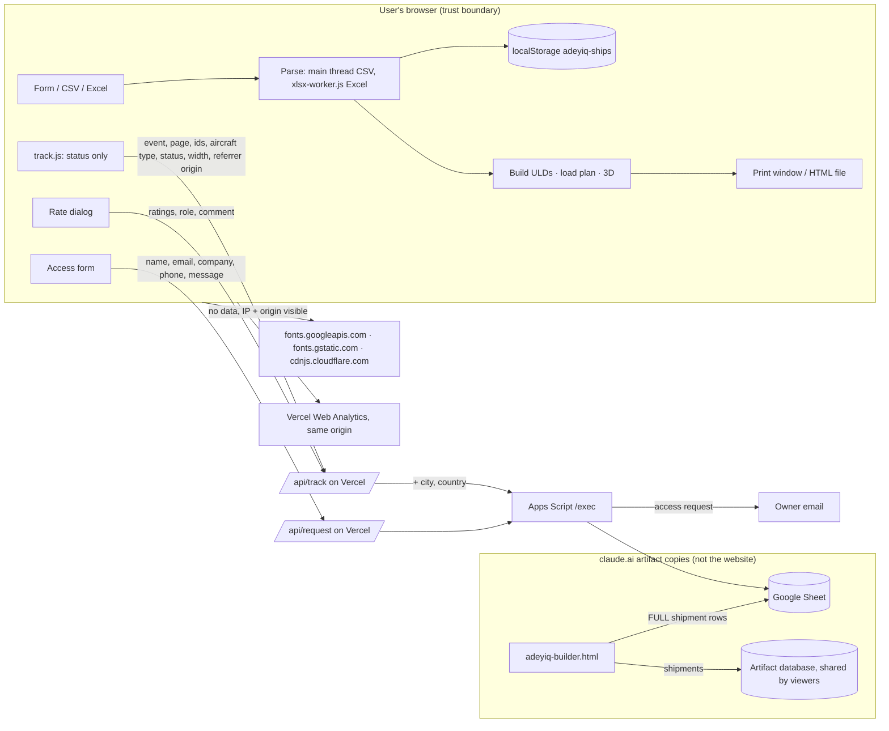

# AdeyIQ data privacy audit

**Date:** 19 November 2026 · branch `security-audit` (fixes not yet deployed)

## Sensitive-data inventory

| Data | Where it is created | Where it is stored | Leaves the browser? |
|---|---|---|---|
| Cargo: AWB, goods, pieces, L×W×H, weight, SHC, DG class, UN, overhang, manual pallet | Builder form, CSV/Excel upload | Memory; `localStorage["adeyiq-ships"]` | **No** (website). **Yes** in the claude.ai artifact copy (see residual risks) |
| Built ULDs, positions, balance | Computed in the browser | Memory only | **No** |
| Print / PDF / HTML exports | Generated in the browser | A new browser window, or a file the user saves | **No** |
| Uploaded file bytes | User's disk | Read once in memory (Excel in `xlsx-worker.js`), never stored | **No** |
| Usage event: event name, page path, random visitor and session id, aircraft type, short status, screen width, referrer origin | `track.js`, builder | Google Sheet "Usage" | Yes → AdeyIQ (Vercel) → Google |
| Network location: country, region, city | Vercel headers on the server | Google Sheet | Yes (derived server-side; IP not stored) |
| Access request: name, email, company, phone, modules, message | Home page form | Google Sheet "Access requests" + owner email | Yes → AdeyIQ → Google |
| Feedback: 5 ratings, role, comment ≤150 chars | ★ Rate dialog | Google Sheet "Usage" | Yes. The comment is free text a user could put cargo details in |
| `adeyiq-vid`, `adeyiq-owner`, `adeyiq-ac`, feedback flags | `track.js`, builder, hold view | `localStorage` | Visitor id only (in usage events) |

## Data-flow diagram

## Every observed network destination

Captured with Chrome DevTools Protocol (`Network.requestWillBeSent`) during the e2e privacy test, using synthetic
cargo with distinctive markers (`999-77700011`, `ZQXPRIVATECARGO`, `UN3456`, `137x41x59`, `4321` kg):

| Destination | Requests | Carries | Cargo found |
|---|---|---|---|
| `localhost:5300` (AdeyIQ pages, `/api/track`) | 21 | Page loads; usage events (status only) | **None** |
| `fonts.googleapis.com`, `fonts.gstatic.com` | yes | GET of CSS/fonts, no body, no query data | **None** |
| `cdnjs.cloudflare.com` | yes | GET of `xlsx.full.min.js` (page and worker), no body | **None** |
| Mock Google Sheet (stands in for Apps Script) | 13 forwarded rows | Usage rows | **None** |

On production, Vercel Web Analytics also loads `/_vercel/insights/script.js` and sends page views to the same origin
(page path only). Not captured locally (the script exists only on Vercel); our URLs never contain cargo.

**Flows exercised:** opening the builder, CSV upload, Excel upload, manual entry, build, ULD 3D view, Print ULD, load
aircraft, Print / PDF, HTML export, Rebalance, back to step 1, switching aircraft to B777F, browser refresh, Clear.

**Result:** 39 browser requests and 13 forwarded rows contained none of the markers in URLs, bodies or headers.

## Browser persistence

| Storage | Used | Contents | Cleared by |
|---|---|---|---|
| localStorage | Yes | `adeyiq-ships` (cargo), `adeyiq-vid`, `adeyiq-owner`, `adeyiq-ac`, feedback flags | **Clear** button (cargo, verified: 0 shipments and no markers left), or clearing site data |
| sessionStorage, IndexedDB, Cache Storage, cookies | No | – | – |
| Service worker | No | – | – |
| Print window | Temporary | Escaped HTML in memory | Closing the window |
| HTML export | Only if the user saves it | User's downloads folder | The user |

- **Between tabs:** tabs of the same browser share the cargo (by design, merged on save).
- **Between browsers or devices:** nothing is shared. There is no server copy.
- **Shared computers:** cargo stays until Clear is pressed or site data is cleared. The privacy page now says so.

## Verification of the privacy promise

> "Cargo typed or uploaded in the builder is saved only in the user's browser and is not sent to AdeyIQ."

| Claim | Result |
|---|---|
| Website does not send cargo to AdeyIQ servers | **Verified** (code + network capture) |
| Website does not send cargo to third parties | **Verified** (third-party requests are file downloads without data) |
| Usage events contain no cargo details | **Was partly untrue** (totals, DG flag, ULD ids). **Fixed and verified** |
| Clearing removes saved cargo | **Verified** |
| Privacy page matches behaviour | **Updated** on the branch: status-only events, referrer origin, Clear advice, Vercel Web Analytics |
| claude.ai artifact copies follow the same promise | **No** (A-1) |

## Residual privacy risks

1. **claude.ai artifact copies** send and share cargo (High, owner decision).
2. **Free-text fields** (feedback comment, access-request message) can contain whatever a user types, including cargo.
3. **Third parties see visitors' IP addresses** when fonts and SheetJS load (Google, Cloudflare). They see the site
   origin as referrer, not the page or any data. Self-hosting removes this.
4. **Vercel** keeps short-term request logs (IP, path) under its own policy. No cargo is in paths.
5. **Analytics records** (city, visitor id) have no retention period yet. That's an owner decision.
6. **Browser extensions** on a user's machine can read any page content. Outside AdeyIQ's control.
